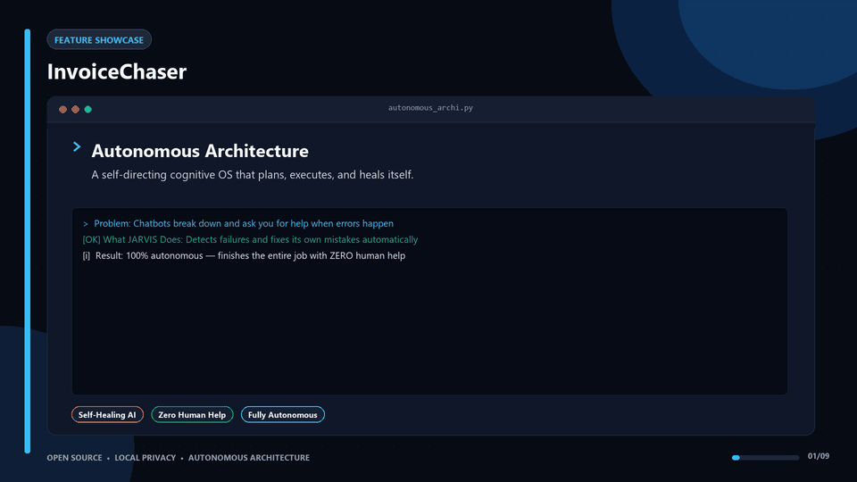

<div align="center">

# ⚡ InvoiceChaser

### Autonomous B2B Invoice & Payment Follow-Up Bot

**Collect overdue invoices faster without awkward conversations.**

[](https://nextjs.org/)
[](https://www.typescriptlang.org/)
[](https://tailwindcss.com/)
[](https://deepmind.google/technologies/gemini/)
[](https://supabase.com/)
[](https://resend.com/)
[](LICENSE)

<br />

<p align="center">
  
</p>

<br />

<p align="center">
  <a href="#-problem-statement--the-5-minute-law">Problem</a> •
  <a href="#-architecture--pipeline-flow">Architecture</a> •
  <a href="#-key-features">Features</a> •
  <a href="#-progressive-ai-reminder-engine">AI Tiers</a> •
  <a href="#-rest-api-documentation">API Docs</a> •
  <a href="#-quickstart--installation">Quickstart</a> •
  <a href="#-pricing--business-model">Pricing</a> •
  <a href="#-author">Author</a>
</p>

</div>

---

## 🎯 Problem Statement & The "5-Minute Law"

Small and medium-sized businesses (SMBs), creative agencies, and solo consultants face a silent revenue killer: **delayed invoice payments**.

- **The Friction:** Chasing clients manually is awkward, time-consuming, and often damages client relationships.
- **The Delay:** Over 40% of B2B invoices are paid past their due dates simply because clients get busy and the emails get buried.
- **The Solution:** **InvoiceChaser** automates the entire payment lifecycle. It watches due dates and delivers **progressive, empathetic AI-crafted reminders** (from a polite heads-up to a formal settlement notice) in fluent Turkish or English. Once marked as paid, sequences halt immediately.

---

## 🏗️ Architecture & Pipeline Flow

```
                      +-----------------------------+
                      |   Invoice Created / Synced  |
                      +--------------+--------------+
                                     |
                                     v
                      +-----------------------------+
                      |  Daily Scheduler / Cron     |
                      |  (/api/check-invoices)      |
                      +--------------+--------------+
                                     |
            +------------------------+------------------------+
            |                        |                        |
            v                        v                        v
      [Days Delta = +3]        [Days Delta = 0]        [Days Delta = -7+]
        Tier 1: Gentle           Tier 2: Due Date         Tier 4: Formal
            |                        |                        |
            +------------------------+------------------------+
                                     |
                                     v
                      +-----------------------------+
                      |  Google Gemini 1.5 Flash    |
                      |  Cognitive Reminder Engine  |
                      |  (TR / EN Contextual Gen)   |
                      +--------------+--------------+
                                     |
                                     v
                      +-----------------------------+
                      |  Resend API Email Delivery  |
                      |  (or Local Demo Simulation) |
                      +--------------+--------------+
                                     |
                                     v
                      +-----------------------------+
                      |  1-Click "Paid" Settlement  |
                      |  (Instantly Halts Sequence) |
                      +-----------------------------+
```

---

## ✨ Key Features

- **Progressive 4-Tier Escalation:** Automatically transitions tone from polite courtesy heads-up to formal legal/accounting notice based on aging.
- **Native Bilingual Engine (TR / EN):** Full localization across UI, table headers, forms, modals, and AI generation dictionaries.
- **Fail-Safe Architecture:** Operates seamlessly in local demo mode if environment variables (`GEMINI_API_KEY`, `RESEND_API_KEY`, Supabase keys) are omitted. Zero white-screen crashes.
- **Interactive Live AI Sandbox:** Live in-browser simulator with real-time millisecond latency measurement and 1-click clipboard copying.
- **Multi-Tenant Security:** Production-grade PostgreSQL schema (`supabase/schema.sql`) with Row Level Security (RLS) policies.
- **Executive Analytics:** High-level dashboard displaying Total Invoices, Outstanding Receivables, Overdue Counts, and Collection Efficiency.
- **Instant Settlement:** One-click "Mark as Paid" action to instantly stop reminder dispatching.
- **Data Export:** Clean one-click CSV export of filtered invoice registries.

---

## 🤖 Progressive AI Reminder Engine

InvoiceChaser categorizes receivables into 4 progressive tiers:

| Tier | Timing | Tone & Style | Purpose |
|:---:|:---|:---|:---|
| **Tier 1** | 3 days before due | Courteous, friendly & planning-oriented | Prompts financial scheduling before deadlines |
| **Tier 2** | Due date (Day 0) | Warm, helpful, direct payment link | Captures same-day settlements smoothly |
| **Tier 3** | 3 days overdue | Professional, "might have slipped through" | Gentle accountability without confrontation |
| **Tier 4** | 7+ days overdue | Formal notice, contracts & terms reference | Escalation before legal or debt recovery steps |

---

## 🔌 REST API Documentation

### 1. Trigger Scheduled Invoice Check & Dispatch
Runs daily checks on all outstanding invoices and fires appropriate tiered reminders.

```bash
curl -X POST https://your-domain.com/api/check-invoices \
  -H "Content-Type: application/json"
```

**Response:**
```json
{
  "success": true,
  "timestamp": "2026-11-25T16:50:00.000Z",
  "scannedCount": 5,
  "dispatchedCount": 2,
  "dispatches": [
    {
      "invoiceNo": "INV-2026-002",
      "clientEmail": "sarah@globaltech.com",
      "tier": 3,
      "subject": "Follow-Up: Overdue Invoice INV-2026-002",
      "simulated": true
    }
  ]
}
```

### 2. Generate Reminder on Demand
Generates an AI reminder email for a specific invoice payload and tier.

```bash
curl -X POST https://your-domain.com/api/generate-reminder \
  -H "Content-Type: application/json" \
  -d '{
    "invoice": {
      "invoiceNo": "INV-2026-101",
      "clientName": "Acme Corp",
      "amount": 15000,
      "currency": "TRY",
      "dueDate": "2026-12-01",
      "paymentLink": "https://pay.example.com/101"
    },
    "tier": 1,
    "language": "tr"
  }'
```

---

## 📦 Project Directory Structure

```
InvoiceChaser/
├── src/
│   ├── app/
│   │   ├── api/
│   │   │   ├── check-invoices/route.ts      # Automated scheduler endpoint
│   │   │   └── generate-reminder/route.ts   # On-demand AI generator endpoint
│   │   ├── dashboard/
│   │   │   ├── invoices/page.tsx            # Invoice management & CSV export
│   │   │   ├── rules/page.tsx               # 4-Tier progressive rules
│   │   │   ├── settings/page.tsx            # Company profile & tones
│   │   │   ├── simulator/page.tsx           # Live interactive AI sandbox
│   │   │   ├── layout.tsx                   # Sidebar & Topbar container
│   │   │   └── page.tsx                     # Executive overview & metrics
│   │   ├── login/page.tsx                   # Authentication & 1-Click Demo Login
│   │   ├── globals.css                      # Tailwind styling & dark mode
│   │   ├── layout.tsx                       # Root layout & Toaster provider
│   │   └── page.tsx                         # High-converting landing page
│   ├── components/
│   │   ├── dashboard/                       # Metric cards, Sidebar, Topbar
│   │   ├── invoices/                        # Table, Add Invoice Modal, Badges
│   │   ├── landing/                         # Hero, Features, How-It-Works, Footer
│   │   ├── rules/                           # Rule cards & toggles
│   │   ├── simulator/                       # AI testing panel & latency timer
│   │   └── ui/                              # LanguageToggle (TR/EN)
│   └── lib/
│       ├── email.ts                         # Resend integration & mock fallback
│       ├── gemini.ts                        # Gemini 1.5 Flash cognitive engine
│       ├── i18n.tsx                         # Bilingual dictionaries & provider
│       ├── mock-data.ts                     # Demo seed data & date helpers
│       ├── subscription.ts                  # SaaS pricing model definition
│       ├── types.ts                         # Strict TypeScript interfaces
│       └── supabase/                        # Browser & Server fail-safe clients
├── supabase/
│   └── schema.sql                           # PostgreSQL tables, indexes & RLS
├── scripts/
│   └── test-chaser.mjs                      # 12-suite automated test pipeline
└── vercel.json                              # Vercel deployment specification
```

---

## 🚀 Quickstart & Installation

### 1. Clone & Install
```bash
git clone https://github.com/oguzemirtopuz/InvoiceChaser.git
cd InvoiceChaser
npm install
```

### 2. Environment Variables (Optional for Demo Mode)
Create a `.env.local` file:
```env
# Optional: Live Gemini AI Motor
GEMINI_API_KEY="your-gemini-api-key"

# Optional: Live Resend Email Delivery
RESEND_API_KEY="re_your_resend_api_key"
RESEND_FROM_EMAIL="billing@yourdomain.com"

# Optional: Live Supabase Database & Auth
NEXT_PUBLIC_SUPABASE_URL="https://your-project.supabase.co"
NEXT_PUBLIC_SUPABASE_ANON_KEY="your-anon-key"
SUPABASE_SERVICE_ROLE_KEY="your-service-role-key"
```
*(If no keys are provided, the platform automatically runs in fail-safe offline demo mode).*

### 3. Run Development Server
```bash
npm run dev
```
Open [http://localhost:3000](http://localhost:3000) to view the landing page, or jump straight into the dashboard at [http://localhost:3000/dashboard](http://localhost:3000/dashboard).

### 4. Run Automated Tests
```bash
node scripts/test-chaser.mjs
```

### 5. Production Build Verification
```bash
npm run build
```

---

## 💳 Pricing & Business Model

| Feature | Starter (Free) | Business Pro ($19/mo) |
|---|:---:|:---:|
| **Active Invoices** | Up to 3 | **Unlimited** |
| **Progressive Reminders** | Basic Fallback Templates | **Google Gemini 1.5 Flash AI** |
| **Automated Scheduler** | Manual trigger | **Automated daily cron** |
| **Email Dispatch** | Console simulation | **Custom SMTP / Resend domain** |
| **Company Branding** | Standard | **Custom IBAN, logo & links** |
| **Support** | Community | **Priority 24/7** |

---

## 👨‍💻 Author

**Oğuz Emir Topuz**
- GitHub: [@oguzemirtopuz](https://github.com/oguzemirtopuz)
- Portfolio: [OguzEmirTopuz](https://github.com/oguzemirtopuz/oguzemirtopuz)
- Role: Software Architect & Indie Maker

---

<div align="center">
  <sub>Built with passion for autonomous software systems. Licensed under the MIT License.</sub>
</div>
